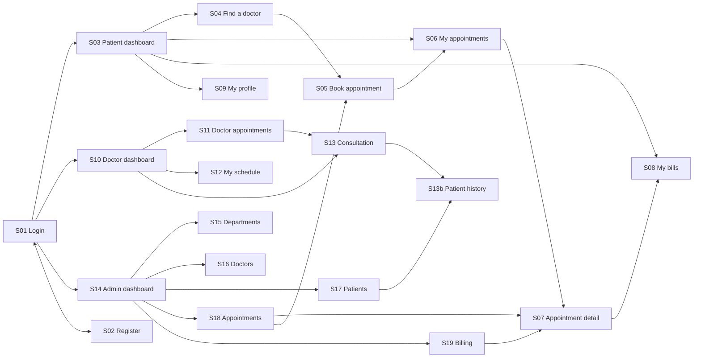
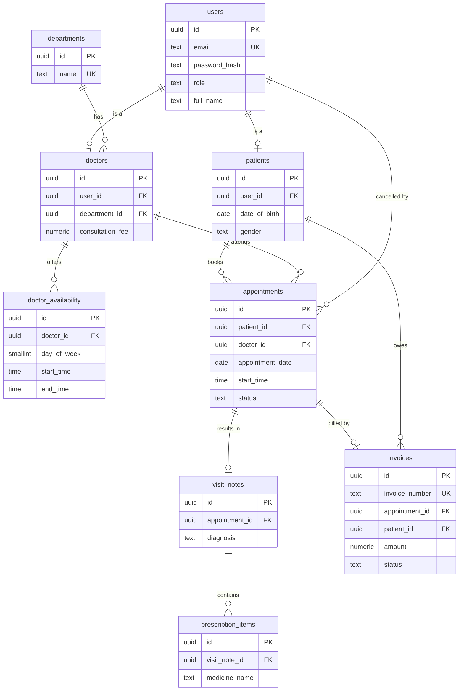

# Hospital Portal — Business Specification

| | |
|---|---|
| Status | Draft for owner review |
| Version | 0.1 |
| Date | 2026-11-18 |
| Tracking issue | #1 |
| Companion doc | [High-level technical solution](technical-solution.md) |

## 1. Purpose and scope

Hospital Portal is a **learning app**: a web portal where patients book appointments with doctors, doctors record consultations, and an admin runs the hospital's master data and billing. It is not intended for real hospital use and never holds real patient data.

### 1.1 Assumptions made in this draft

The owner has not yet specified the functional scope, so this draft proposes one. Each assumption below is open to change.

| # | Assumption |
|---|---|
| A1 | Three user roles: Patient, Doctor, Admin. The admin also covers front-desk duties. |
| A2 | Single hospital, single location, one time zone (the hospital's local time). |
| A3 | English only. Currency shown as a plain amount with a configurable symbol. |
| A4 | Billing is one invoice per completed appointment, for the doctor's consultation fee. Payment is recorded manually by the admin; there is no online payment. |
| A5 | Login is email and password. Patients self-register; doctors are created by the admin; the first admin is created by a seed script. |
| A6 | No email or SMS notifications. |

### 1.2 Out of scope (possible later phases)

Lab results, pharmacy and inventory, inpatient/bed management, online payments, insurance, notifications, file uploads, a separate receptionist role, multi-branch support, password reset by email, and audit logging.

## 2. User roles

| Role | Who | What they can do |
|---|---|---|
| Patient | Self-registered member of the public | Find doctors, book and cancel own appointments, view own visit notes, prescriptions and invoices, edit own profile |
| Doctor | Created by admin | View own appointments, set weekly availability, record visit notes and prescriptions, view history of patients they have an appointment with |
| Admin | Seeded | Manage departments, doctors and patients; view, book and cancel any appointment; manage invoices and record payments |

## 3. Business requirements

### 3.1 Accounts and access

| ID | Requirement |
|---|---|
| BR-01 | A visitor can register as a patient with name, email, password, phone, date of birth and gender. Email must be unique. |
| BR-02 | Passwords have at least 8 characters with at least one letter and one digit, and are stored only as a hash. |
| BR-03 | A user signs in with email and password and is taken to the dashboard for their role. |
| BR-04 | Every page except Login and Register requires sign-in. Each page and API is restricted to the roles listed for it. |
| BR-05 | A deactivated user cannot sign in. |
| BR-06 | A patient sees only their own data. A doctor sees only their own appointments and the history of patients who have at least one appointment with them. |

### 3.2 Master data

| ID | Requirement |
|---|---|
| BR-10 | The admin can create, edit and deactivate departments. Department names are unique. |
| BR-11 | The admin can create a doctor (which also creates the doctor's login), edit the doctor's details and deactivate the doctor. |
| BR-12 | A deactivated department or doctor is hidden from booking but kept on historical records. |
| BR-13 | A doctor sets weekly availability: for each weekday, zero or more time ranges, each with a slot length (15, 20, 30 or 60 minutes). Ranges on the same day must not overlap. |

### 3.3 Appointments

| ID | Requirement |
|---|---|
| BR-20 | Bookable slots for a doctor on a date are generated from that weekday's availability, minus slots already booked, minus slots in the past. |
| BR-21 | Appointments can be booked from today up to 30 days ahead. |
| BR-22 | A slot can hold only one active appointment. A double-booking attempt is rejected with a clear message. |
| BR-23 | A patient cannot hold two active appointments that overlap in time. |
| BR-24 | Appointment statuses: `booked`, `completed`, `cancelled`, `no_show`. New appointments start as `booked`. |
| BR-25 | A patient can cancel their own `booked` appointment up to 2 hours before its start. The admin can cancel any `booked` appointment at any time. A reason is required. |
| BR-26 | A doctor or admin can mark a `booked` appointment as `no_show` once its start time has passed. |
| BR-27 | `completed`, `cancelled` and `no_show` are final; the status cannot change again. |

### 3.4 Consultation

| ID | Requirement |
|---|---|
| BR-30 | The doctor records a visit note for a `booked` appointment on or after its date: symptoms, diagnosis, notes and an optional follow-up date. |
| BR-31 | The doctor can add zero or more prescription items: medicine name, dosage, frequency, duration in days and instructions. |
| BR-32 | Saving the visit note with "Complete consultation" sets the appointment to `completed`. |
| BR-33 | The doctor can edit the visit note and prescription until the end of the appointment day. After that they are read-only. |
| BR-34 | The patient can view the visit note and prescription once the appointment is `completed`. |

### 3.5 Billing

| ID | Requirement |
|---|---|
| BR-40 | When an appointment becomes `completed`, an invoice is created automatically for the doctor's consultation fee at that moment, with status `unpaid`. |
| BR-41 | Invoice numbers are unique and sequential in the form `INV-000001`. |
| BR-42 | The admin records payment by choosing a method (`cash`, `card` or `upi`), which sets the invoice to `paid` with a paid timestamp. |
| BR-43 | The admin can mark an `unpaid` invoice as `void`. `paid` and `void` are final. |
| BR-44 | A patient can view their own invoices. |

## 4. Navigation and page integration

### 4.1 Application shell

Every signed-in page shares one shell:

- **Top bar:** app name, signed-in user's name and role, and a user menu with "My profile" and "Sign out".
- **Side navigation:** links that depend on the role (below). The current page is highlighted. On narrow screens it collapses into a menu button.
- **Content area:** page title, optional action button, then the page body.
- **Feedback:** success and error messages appear as toasts; destructive actions ask for confirmation in a dialog.

| Role | Side navigation items |
|---|---|
| Patient | Dashboard, Find a doctor, My appointments, My bills, My profile |
| Doctor | Dashboard, My appointments, My schedule, My profile |
| Admin | Dashboard, Appointments, Patients, Doctors, Departments, Billing |

### 4.2 Screen map



### 4.3 How data flows between pages

| Flow | Pages involved | What links them |
|---|---|---|
| Booking | S04 → S05 → S06 | The doctor chosen in S04 is passed to S05 by doctor id in the URL. A successful booking redirects to S06, where the new appointment appears first. |
| Availability to slots | S12 → S05 | Availability saved by the doctor in S12 determines the slots S05 offers. |
| Consultation | S10/S11 → S13 → S07 | The doctor opens an appointment in S13 and completes it. The patient then sees the visit note and prescription in S07. |
| Billing | S13 → S19 → S08 | Completing a consultation creates an invoice, which appears in the admin's S19 and the patient's S08. Recording payment in S19 updates the status in S08. |
| Master data | S15 → S16 → S04 | Departments from S15 populate the department selector in S16 and the filter in S04. Doctors from S16 are the list in S04. |
| Dashboards | all → S03/S10/S14 | Dashboard counts and lists are computed live from appointments and invoices. |

## 5. Screens

Each screen lists its route, who can open it, a wireframe, its components, the values it shows and the APIs it calls. API ids refer to section 6.

### S01 — Login

- **Route:** `/login` · **Roles:** public (signed-in users are redirected to their dashboard)

```
+--------------------------------------+
|           Hospital Portal            |
|  Email     [____________________]    |
|  Password  [____________________]    |
|            [      Sign in       ]    |
|  New patient? Register               |
+--------------------------------------+
```

| Component | Description | Values / behaviour |
|---|---|---|
| Email field | Text input | Required, valid email |
| Password field | Password input with show/hide | Required |
| Sign in button | Submits the form | Disabled while submitting |
| Error banner | Shown on failure | "Invalid email or password" or "Account is deactivated" |
| Register link | Goes to S02 | — |

**APIs:** API-02.

### S02 — Patient registration

- **Route:** `/register` · **Roles:** public

```
+--------------------------------------+
|        Create patient account        |
|  Full name      [______________]     |
|  Email          [______________]     |
|  Phone          [______________]     |
|  Date of birth  [__/__/____]         |
|  Gender         (o) F (o) M (o) Other|
|  Password       [______________]     |
|  Confirm        [______________]     |
|                 [   Register   ]     |
|  Already registered? Sign in         |
+--------------------------------------+
```

| Component | Description | Values / behaviour |
|---|---|---|
| Registration form | Seven fields with inline validation | Rules from BR-01 and BR-02; date of birth must be in the past; phone 7–15 digits |
| Register button | Creates the account, signs in, redirects to S03 | — |
| Error messages | Per field, plus "Email already registered" | — |

**APIs:** API-01.

### S03 — Patient dashboard

- **Route:** `/patient` · **Roles:** Patient

```
+------------------------------------------------------+
| Welcome, <full name>                                 |
| [Upcoming: 2] [Completed: 5] [Unpaid bills: 1]       |
| Next appointment                                     |
|  Dr <name> · <department> · <date> <time>  [View]    |
| Recent visits                                        |
|  <date>  Dr <name>  <diagnosis>            [View]    |
| [ Book an appointment ]                              |
+------------------------------------------------------+
```

| Component | Values shown |
|---|---|
| Summary cards | Count of upcoming `booked` appointments, count of `completed` appointments, count and total amount of `unpaid` invoices |
| Next appointment card | Doctor name, department, date, start time; empty state "No upcoming appointments" |
| Recent visits list | Last 3 completed appointments: date, doctor, diagnosis; each links to S07 |
| Book button | Goes to S04 |

**APIs:** API-27.

### S04 — Find a doctor

- **Route:** `/patient/doctors` · **Roles:** Patient

```
+------------------------------------------------------+
| Find a doctor                                        |
| Department [All v]   Search [name or specialty___]   |
| +----------------+ +----------------+                |
| | Dr <name>      | | Dr <name>      |                |
| | <department>   | | <department>   |                |
| | <specialty>    | | <specialty>    |                |
| | <n> yrs · <fee>| | <n> yrs · <fee>|                |
| | [Book]         | | [Book]         |                |
| +----------------+ +----------------+                |
+------------------------------------------------------+
```

| Component | Values shown |
|---|---|
| Department filter | Active departments, plus "All" |
| Search box | Filters by doctor name or specialization as the user types |
| Doctor card | Name, department, specialization, qualification, years of experience, consultation fee |
| Book button | Goes to S05 for that doctor |
| Empty state | "No doctors match your search" |

**APIs:** API-05, API-08.

### S05 — Book appointment

- **Route:** `/patient/doctors/[doctorId]/book` (admin: `/admin/appointments/new`) · **Roles:** Patient, Admin

```
+------------------------------------------------------+
| Book appointment                                     |
| Dr <name> · <department> · Fee <fee>                 |
| (admin only) Patient [search patient________ v]      |
| Date  [ < ] <Mon 23 Nov> [ > ]   (next 30 days)      |
| Slots [09:00] [09:30] [10:00] [10:30] ...            |
| Reason for visit [______________________________]    |
|                         [Cancel] [Confirm booking]   |
+------------------------------------------------------+
```

| Component | Values shown |
|---|---|
| Doctor summary | Name, department, specialization, consultation fee |
| Patient selector (admin only) | Search by patient name, email or phone; admin also chooses the doctor first |
| Date picker | Today to today + 30 days |
| Slot grid | Free slots for the chosen date as start times; "No slots available" when empty |
| Reason field | Free text, required, up to 500 characters |
| Confirm button | Books and redirects to S06 (patient) or S18 (admin); on a slot conflict shows "That slot was just taken" and refreshes the slots |

**APIs:** API-09, API-29, API-18; admin variant also API-08 (choose doctor) and API-14 (patient search).

### S06 — My appointments

- **Route:** `/patient/appointments` · **Roles:** Patient

```
+------------------------------------------------------+
| My appointments              [ Book an appointment ] |
| [Upcoming] [Past] [Cancelled]                        |
| Date       Time   Doctor       Dept      Status      |
| 23 Nov 26  09:30  Dr <name>    <dept>    Booked [View] [Cancel]
+------------------------------------------------------+
```

| Component | Values shown |
|---|---|
| Tabs | Upcoming (`booked`, today or later), Past (`completed`, `no_show`), Cancelled |
| Appointment table | Date, start time, doctor, department, status badge |
| View action | Goes to S07 |
| Cancel action | Only on cancellable rows (BR-25); opens a dialog asking for a reason |

**APIs:** API-17, API-20.

### S07 — Appointment detail

- **Route:** `/patient/appointments/[id]` (admin: `/admin/appointments/[id]`) · **Roles:** Patient (own), Admin

```
+------------------------------------------------------+
| Appointment · <status badge>                         |
| Doctor <name> · <department>                         |
| Patient <name>   Date <date>  Time <start>–<end>     |
| Reason: <reason>                                     |
| -- Visit summary (when completed) -----------------  |
| Symptoms: ...   Diagnosis: ...   Notes: ...          |
| Follow-up: <date>                                    |
| Prescription                                         |
|  Medicine   Dosage  Frequency  Days  Instructions    |
| -- Invoice --------------------------------------    |
| <invoice no> · <amount> · <status>       [View bill] |
|                                  [Cancel appointment]|
+------------------------------------------------------+
```

| Component | Values shown |
|---|---|
| Header | Status badge; cancel reason and who cancelled when `cancelled` |
| Appointment details | Doctor, department, patient, date, start and end time, reason |
| Visit summary | Symptoms, diagnosis, notes, follow-up date — only when `completed` |
| Prescription table | Medicine name, dosage, frequency, duration in days, instructions |
| Invoice strip | Invoice number, amount, status; links to S08 (patient) or S19 (admin) |
| Cancel button | As in S06; admin can also mark `no_show` (BR-26) |

**APIs:** API-19, API-20, API-21.

### S08 — My bills

- **Route:** `/patient/bills` · **Roles:** Patient

```
+------------------------------------------------------+
| My bills                    Total unpaid: <amount>   |
| Invoice     Date       Doctor      Amount   Status   |
| INV-000012  20 Nov 26  Dr <name>   500.00   Unpaid   |
+------------------------------------------------------+
```

| Component | Values shown |
|---|---|
| Unpaid total | Sum of `unpaid` invoice amounts |
| Invoice table | Invoice number, issue date, doctor, amount, status, payment method and paid date when paid |
| Row click | Opens the related appointment in S07 |

**APIs:** API-24.

### S09 — My profile

- **Route:** `/profile` · **Roles:** Patient, Doctor, Admin

```
+------------------------------------------------------+
| My profile                                           |
| Full name [________]  Email <read-only>              |
| Phone     [________]                                 |
| (patient) DOB [____] Gender [__] Blood group [__]    |
| (patient) Address [_______________________]          |
| (patient) Emergency contact [name] [phone]           |
| (doctor)  Specialization, qualification, bio         |
|                                   [Save changes]     |
| Change password: Current [__] New [__] Confirm [__]  |
|                                   [Update password]  |
+------------------------------------------------------+
```

| Component | Values shown |
|---|---|
| Account section | Full name and phone (editable), email and role (read-only) |
| Patient section | Date of birth, gender, blood group, address, emergency contact name and phone |
| Doctor section | Specialization, qualification, experience and bio (editable); department and fee (read-only, set by admin) |
| Change password | Current password, new password, confirmation |

**APIs:** API-03, API-04, API-28.

### S10 — Doctor dashboard

- **Route:** `/doctor` · **Roles:** Doctor

```
+------------------------------------------------------+
| Good morning, Dr <name>                              |
| [Today: 8] [Completed today: 3] [This week: 31]      |
| Today's appointments                                 |
| Time   Patient      Reason            Status         |
| 09:00  <name>       <reason>          Booked [Open]  |
+------------------------------------------------------+
```

| Component | Values shown |
|---|---|
| Summary cards | Appointments today, completed today, booked in the next 7 days |
| Today's list | Start time, patient name, age, reason, status; Open goes to S13 |
| Empty state | "No appointments today" |

**APIs:** API-27.

### S11 — Doctor appointments

- **Route:** `/doctor/appointments` · **Roles:** Doctor

```
+------------------------------------------------------+
| My appointments                                      |
| From [date] To [date]  Status [All v]                |
| Date       Time   Patient    Reason     Status       |
| 23 Nov 26  09:30  <name>     <reason>   Booked [Open]|
+------------------------------------------------------+
```

| Component | Values shown |
|---|---|
| Filters | Date range (default today to +7 days), status |
| Appointment table | Date, start time, patient name, reason, status; paginated 20 per page |
| Open action | Goes to S13 |

**APIs:** API-17.

### S12 — My schedule

- **Route:** `/doctor/schedule` · **Roles:** Doctor

```
+------------------------------------------------------+
| My weekly schedule                                   |
| Mon  [09:00]–[13:00] slot [30 v]  [x]   [+ Add range]|
| Tue  [09:00]–[13:00] slot [30 v]  [x]                |
|      [15:00]–[18:00] slot [20 v]  [x]   [+ Add range]|
| Wed  Not available                      [+ Add range]|
| ...                                                  |
|                                      [Save schedule] |
+------------------------------------------------------+
```

| Component | Values shown |
|---|---|
| Day rows | Monday to Sunday, each with zero or more time ranges |
| Time range | Start time, end time, slot length (15/20/30/60 minutes), remove button |
| Add range | Adds a range to that day |
| Save | Replaces the whole weekly schedule; validates end after start and no overlaps (BR-13) |
| Notice | "Changes apply to future bookings; existing appointments are not affected" |

**APIs:** API-12, API-13.

### S13 — Consultation

- **Route:** `/doctor/appointments/[id]` · **Roles:** Doctor (own appointments)

```
+------------------------------------------------------+
| Consultation · <status>                              |
| <patient name> · <age> · <gender> · <blood group>    |
| <date> <time> · Reason: <reason>   [Patient history] |
| Symptoms   [______________________________]          |
| Diagnosis  [______________________________]          |
| Notes      [______________________________]          |
| Follow-up  [__/__/____]                              |
| Prescription                          [+ Add medicine]|
|  [medicine] [dosage] [frequency] [days] [instr.] [x] |
|        [Mark no-show] [Save draft] [Complete consultation]
+------------------------------------------------------+
```

| Component | Values shown |
|---|---|
| Patient header | Name, age, gender, blood group, phone |
| Appointment info | Date, time, reason, status |
| Patient history button | Opens S13b |
| Visit note form | Symptoms and diagnosis (required to complete), notes, follow-up date (must be after the appointment date) |
| Prescription editor | Rows of medicine name, dosage, frequency, duration in days, instructions |
| Save draft | Saves without changing status |
| Complete consultation | Saves, sets `completed`, creates the invoice (BR-32, BR-40) |
| Mark no-show | Available after the start time (BR-26) |
| Read-only mode | After the edit window (BR-33) or when cancelled/no-show |

**APIs:** API-19, API-21, API-22, API-23.

### S13b — Patient history

- **Route:** `/doctor/patients/[patientId]` (admin: `/admin/patients/[patientId]`) · **Roles:** Doctor (BR-06), Admin

```
+------------------------------------------------------+
| <patient name> · <age> · <gender> · <blood group>    |
| Phone <phone> · Emergency <name> <phone>             |
| Visit history                                        |
| v 20 Nov 26 · Dr <name> · <diagnosis>                |
|     Symptoms / Notes / Prescription table            |
| > 02 Oct 26 · Dr <name> · <diagnosis>                |
+------------------------------------------------------+
```

| Component | Values shown |
|---|---|
| Patient summary | Name, age, gender, blood group, phone, address, emergency contact |
| Visit timeline | Completed appointments, newest first: date, doctor, diagnosis; expanding shows symptoms, notes, follow-up date and prescription |
| Admin extras | Edit patient details and activate/deactivate the account |

**APIs:** API-15, API-16.

### S14 — Admin dashboard

- **Route:** `/admin` · **Roles:** Admin

```
+------------------------------------------------------+
| Admin dashboard                                      |
| [Patients: 120] [Doctors: 14] [Today's appts: 37]    |
| [Unpaid invoices: 9 · <amount>]                      |
| Today's appointments by status                       |
|  Booked 20 · Completed 12 · Cancelled 3 · No-show 2  |
| Recent appointments                                  |
|  <time> <patient> <doctor> <status>          [View]  |
+------------------------------------------------------+
```

| Component | Values shown |
|---|---|
| Summary cards | Active patients, active doctors, appointments today, unpaid invoice count and total |
| Status breakdown | Today's appointments counted by status |
| Recent appointments | Latest 10 bookings: time, patient, doctor, status; links to S07 |

**APIs:** API-27.

### S15 — Departments

- **Route:** `/admin/departments` · **Roles:** Admin

```
+------------------------------------------------------+
| Departments                        [+ New department]|
| Name          Description        Doctors  Status     |
| Cardiology    Heart care         3        Active [Edit]
+------------------------------------------------------+
```

| Component | Values shown |
|---|---|
| Department table | Name, description, number of doctors, status |
| New/Edit dialog | Name (required, unique), description, active toggle |

**APIs:** API-05, API-06, API-07.

### S16 — Doctors

- **Route:** `/admin/doctors` · **Roles:** Admin

```
+------------------------------------------------------+
| Doctors                                [+ New doctor]|
| Department [All v]  Search [__________]              |
| Name      Dept        Specialty   Fee     Status     |
| Dr <name> Cardiology  <spec>      500.00  Active [Edit]
+------------------------------------------------------+
```

| Component | Values shown |
|---|---|
| Filters | Department, search by name |
| Doctor table | Name, email, department, specialization, fee, status |
| New doctor dialog | Full name, email, phone, temporary password, department, specialization, qualification, years of experience, consultation fee, bio |
| Edit dialog | Same fields except email and password, plus active toggle |

**APIs:** API-05, API-08, API-10, API-11.

### S17 — Patients

- **Route:** `/admin/patients` · **Roles:** Admin

```
+------------------------------------------------------+
| Patients                                             |
| Search [name, email or phone______]                  |
| Name     Email        Phone      Registered  Status  |
| <name>   <email>      <phone>    02 Oct 26   Active [View]
+------------------------------------------------------+
```

| Component | Values shown |
|---|---|
| Search | By name, email or phone |
| Patient table | Name, email, phone, age, registration date, status; paginated 20 per page |
| View action | Goes to S13b (admin variant) |

**APIs:** API-14.

### S18 — Appointments (admin)

- **Route:** `/admin/appointments` · **Roles:** Admin

```
+------------------------------------------------------+
| Appointments                      [+ New appointment]|
| From [date] To [date] Doctor [All v] Status [All v]  |
| Date      Time   Patient   Doctor     Status         |
| 23 Nov 26 09:30  <name>    Dr <name>  Booked [View] [Cancel]
+------------------------------------------------------+
```

| Component | Values shown |
|---|---|
| Filters | Date range (default today), doctor, status |
| Appointment table | Date, time, patient, doctor, department, status; paginated 20 per page |
| New appointment | Goes to S05 (admin variant) |
| View / Cancel | S07; cancel dialog with reason |

**APIs:** API-17, API-20, API-08.

### S19 — Billing

- **Route:** `/admin/billing` · **Roles:** Admin

```
+------------------------------------------------------+
| Billing            Unpaid: <amount>  Paid today: <amount>
| Status [All v]  From [date] To [date]  Search [___]  |
| Invoice     Date      Patient   Doctor    Amount Status
| INV-000012  20 Nov 26 <name>    Dr <name> 500.00 Unpaid [Record payment] [Void]
+------------------------------------------------------+
```

| Component | Values shown |
|---|---|
| Totals | Total unpaid amount, total paid today |
| Filters | Status, issue date range, search by invoice number or patient name |
| Invoice table | Invoice number, issue date, patient, doctor, amount, status, payment method, paid date |
| Record payment dialog | Shows amount; choose method (`cash`, `card`, `upi`); confirm (BR-42) |
| Void action | Confirmation dialog (BR-43) |

**APIs:** API-24, API-25, API-26.

### Shared states

All screens share: a loading skeleton while data loads, an inline error with a retry button when a request fails, a "Not found" page for unknown ids, and a "You don't have access to this page" page for a wrong role.

## 6. Backend APIs

All APIs are JSON over HTTPS under `/api`, served by the same Next.js app. Unless marked public, they require a signed-in session and return `401` without one and `403` for a wrong role.

**Conventions**

- Success: `200` (or `201` on create) with `{ "data": ... }`. Lists also return `{ "page", "pageSize", "total" }`.
- Error: `{ "error": { "code": "...", "message": "...", "fields": { ... } } }` with `400` validation, `401`, `403`, `404`, `409` conflict.
- Ids are UUIDs. Dates are `YYYY-MM-DD`, times `HH:mm` in hospital local time, timestamps ISO 8601 UTC.

| ID | Method and path | Roles | Purpose | Key inputs | Returns |
|---|---|---|---|---|---|
| API-01 | `POST /api/auth/register` | Public | Register a patient (BR-01) | fullName, email, password, phone, dateOfBirth, gender | Created user; `409` if email exists |
| API-02 | `POST /api/auth/[...nextauth]` | Public | Sign in, sign out and session, handled by the auth library | email, password | Session cookie |
| API-03 | `GET /api/me` | All | Current user with patient or doctor profile | — | User and profile |
| API-04 | `PATCH /api/me` | All | Update own profile | Editable profile fields | Updated profile |
| API-05 | `GET /api/departments` | All | List departments | `includeInactive` (admin) | Departments with doctor count |
| API-06 | `POST /api/departments` | Admin | Create department (BR-10) | name, description | Department; `409` on duplicate name |
| API-07 | `PATCH /api/departments/{id}` | Admin | Edit or deactivate | name, description, isActive | Department |
| API-08 | `GET /api/doctors` | All | List doctors | departmentId, search, `includeInactive` (admin), page | Doctors with department |
| API-09 | `GET /api/doctors/{id}` | All | One doctor's public details | — | Doctor |
| API-10 | `POST /api/doctors` | Admin | Create doctor and login (BR-11) | User fields, password, departmentId, specialization, qualification, experienceYears, consultationFee, bio | Doctor |
| API-11 | `PATCH /api/doctors/{id}` | Admin | Edit or deactivate doctor | Doctor fields, isActive | Doctor |
| API-12 | `GET /api/doctors/{id}/availability` | Doctor (own), Admin | Weekly schedule | — | Availability ranges |
| API-13 | `PUT /api/doctors/{id}/availability` | Doctor (own) | Replace weekly schedule (BR-13) | Array of dayOfWeek, startTime, endTime, slotMinutes | Availability ranges |
| API-14 | `GET /api/patients` | Admin | Search patients | search, page | Patients |
| API-15 | `GET /api/patients/{id}` | Admin, Doctor (BR-06), Patient (own) | Patient details | — | Patient |
| API-16 | `GET /api/patients/{id}/history` | Admin, Doctor (BR-06), Patient (own) | Completed visits with notes and prescriptions | — | Visits |
| API-17 | `GET /api/appointments` | All (scoped to role) | List appointments | from, to, status, doctorId, patientId, page | Appointments |
| API-18 | `POST /api/appointments` | Patient, Admin | Book (BR-20 to BR-23) | doctorId, date, startTime, reason, patientId (admin) | Appointment; `409` if slot taken |
| API-19 | `GET /api/appointments/{id}` | Participants, Admin | Detail with visit note, prescription, invoice | — | Appointment |
| API-20 | `POST /api/appointments/{id}/cancel` | Patient (own), Admin | Cancel (BR-25) | reason | Appointment |
| API-21 | `POST /api/appointments/{id}/no-show` | Doctor (own), Admin | Mark no-show (BR-26) | — | Appointment |
| API-22 | `PUT /api/appointments/{id}/visit-note` | Doctor (own) | Save draft visit note and prescription (BR-30, BR-31, BR-33) | symptoms, diagnosis, notes, followUpDate, items[] | Visit note |
| API-23 | `POST /api/appointments/{id}/complete` | Doctor (own) | Complete and create invoice (BR-32, BR-40) | Same as API-22 | Appointment with invoice |
| API-24 | `GET /api/invoices` | Patient (own), Admin | List invoices | status, from, to, search, page | Invoices with totals |
| API-25 | `POST /api/invoices/{id}/pay` | Admin | Record payment (BR-42) | paymentMethod | Invoice |
| API-26 | `POST /api/invoices/{id}/void` | Admin | Void invoice (BR-43) | — | Invoice |
| API-27 | `GET /api/dashboard` | All | Role-specific dashboard data for S03, S10, S14 | — | Counts and lists |
| API-28 | `POST /api/me/password` | All | Change own password | currentPassword, newPassword | `204` |
| API-29 | `GET /api/doctors/{id}/slots` | Patient, Admin | Free slots for a date (BR-20) | date | Array of startTime, endTime |

## 7. Database

| | |
|---|---|
| Platform | Supabase (PostgreSQL) |
| Supabase project name | `hospital-portal` |
| Database name | `postgres` (fixed by Supabase for every project) |
| Schema | `public` |
| Number of tables | 9 |
| Total columns | 83 |

### 7.1 Entity diagram



### 7.2 Tables

Every `id` is `uuid`, primary key, default `gen_random_uuid()`. Every `created_at` and `updated_at` is `timestamptz`, not null, default `now()`.

#### `users` — 9 columns

| Column | Type | Null | Notes |
|---|---|---|---|
| id | uuid | No | PK |
| email | text | No | Unique, stored lowercase |
| password_hash | text | No | Hash only, never the password |
| role | text | No | `patient`, `doctor` or `admin` (check) |
| full_name | text | No | |
| phone | text | Yes | |
| is_active | boolean | No | Default `true` |
| created_at | timestamptz | No | |
| updated_at | timestamptz | No | |

#### `patients` — 10 columns

| Column | Type | Null | Notes |
|---|---|---|---|
| id | uuid | No | PK |
| user_id | uuid | No | FK → users.id, unique |
| date_of_birth | date | No | |
| gender | text | No | `female`, `male` or `other` (check) |
| blood_group | text | Yes | `A+`, `A-`, `B+`, `B-`, `AB+`, `AB-`, `O+`, `O-` (check) |
| address | text | Yes | |
| emergency_contact_name | text | Yes | |
| emergency_contact_phone | text | Yes | |
| created_at | timestamptz | No | |
| updated_at | timestamptz | No | |

#### `departments` — 6 columns

| Column | Type | Null | Notes |
|---|---|---|---|
| id | uuid | No | PK |
| name | text | No | Unique |
| description | text | Yes | |
| is_active | boolean | No | Default `true` |
| created_at | timestamptz | No | |
| updated_at | timestamptz | No | |

#### `doctors` — 10 columns

| Column | Type | Null | Notes |
|---|---|---|---|
| id | uuid | No | PK |
| user_id | uuid | No | FK → users.id, unique |
| department_id | uuid | No | FK → departments.id |
| specialization | text | No | |
| qualification | text | Yes | |
| experience_years | smallint | No | Default 0, check ≥ 0 |
| consultation_fee | numeric(10,2) | No | Check ≥ 0 |
| bio | text | Yes | |
| created_at | timestamptz | No | |
| updated_at | timestamptz | No | |

#### `doctor_availability` — 9 columns

| Column | Type | Null | Notes |
|---|---|---|---|
| id | uuid | No | PK |
| doctor_id | uuid | No | FK → doctors.id, on delete cascade |
| day_of_week | smallint | No | 0 = Sunday … 6 = Saturday (check 0–6) |
| start_time | time | No | |
| end_time | time | No | Check `end_time > start_time` |
| slot_minutes | smallint | No | 15, 20, 30 or 60 (check) |
| is_active | boolean | No | Default `true` |
| created_at | timestamptz | No | |
| updated_at | timestamptz | No | |

#### `appointments` — 12 columns

| Column | Type | Null | Notes |
|---|---|---|---|
| id | uuid | No | PK |
| patient_id | uuid | No | FK → patients.id |
| doctor_id | uuid | No | FK → doctors.id |
| appointment_date | date | No | |
| start_time | time | No | |
| end_time | time | No | Check `end_time > start_time` |
| status | text | No | `booked`, `completed`, `cancelled`, `no_show` (check), default `booked` |
| reason | text | No | Up to 500 characters |
| cancelled_by | uuid | Yes | FK → users.id |
| cancel_reason | text | Yes | Required when `cancelled` |
| created_at | timestamptz | No | |
| updated_at | timestamptz | No | |

Constraints and indexes: a partial unique index on (`doctor_id`, `appointment_date`, `start_time`) where `status <> 'cancelled'` enforces BR-22 in the database; indexes on (`patient_id`, `appointment_date`) and (`doctor_id`, `appointment_date`).

#### `visit_notes` — 8 columns

| Column | Type | Null | Notes |
|---|---|---|---|
| id | uuid | No | PK |
| appointment_id | uuid | No | FK → appointments.id, unique |
| symptoms | text | Yes | Required to complete |
| diagnosis | text | Yes | Required to complete |
| notes | text | Yes | |
| follow_up_date | date | Yes | |
| created_at | timestamptz | No | |
| updated_at | timestamptz | No | |

#### `prescription_items` — 8 columns

| Column | Type | Null | Notes |
|---|---|---|---|
| id | uuid | No | PK |
| visit_note_id | uuid | No | FK → visit_notes.id, on delete cascade |
| medicine_name | text | No | |
| dosage | text | No | For example "500 mg" |
| frequency | text | No | For example "Twice a day" |
| duration_days | smallint | No | Check > 0 |
| instructions | text | Yes | |
| created_at | timestamptz | No | |

#### `invoices` — 11 columns

| Column | Type | Null | Notes |
|---|---|---|---|
| id | uuid | No | PK |
| invoice_number | text | No | Unique, `INV-000001` format from a sequence |
| appointment_id | uuid | No | FK → appointments.id, unique |
| patient_id | uuid | No | FK → patients.id |
| amount | numeric(10,2) | No | Fee copied at completion (BR-40) |
| status | text | No | `unpaid`, `paid`, `void` (check), default `unpaid` |
| payment_method | text | Yes | `cash`, `card`, `upi` (check) |
| issued_at | timestamptz | No | Default `now()` |
| paid_at | timestamptz | Yes | |
| created_at | timestamptz | No | |
| updated_at | timestamptz | No | |

### 7.3 Seed data

A seed script creates synthetic data only: one admin, five departments, about eight doctors with schedules, about ten patients, and a spread of appointments, visit notes and invoices across all statuses.

## 8. Traceability

| Area | Requirements | Screens | APIs | Tables |
|---|---|---|---|---|
| Accounts | BR-01 – BR-06 | S01, S02, S09 | API-01 – 04, 28 | users, patients |
| Master data | BR-10 – BR-13 | S12, S15, S16, S17 | API-05 – 16 | departments, doctors, doctor_availability, patients |
| Appointments | BR-20 – BR-27 | S04, S05, S06, S07, S11, S18 | API-17 – 21, 29 | appointments |
| Consultation | BR-30 – BR-34 | S13, S13b, S07 | API-16, 22, 23 | visit_notes, prescription_items |
| Billing | BR-40 – BR-44 | S08, S19 | API-24 – 26 | invoices |
| Dashboards | — | S03, S10, S14 | API-27 | (read-only across tables) |

## 9. Open questions for the owner

1. Are the three roles in A1 right, or do you want a separate receptionist role?
2. Is the simple billing in A4 wanted, or should billing be left out of the first version?
3. Is the 30-day booking window and 2-hour cancellation cutoff acceptable?
4. Should visual designs be produced in Figma as well, or are the wireframes here enough for a learning app?
