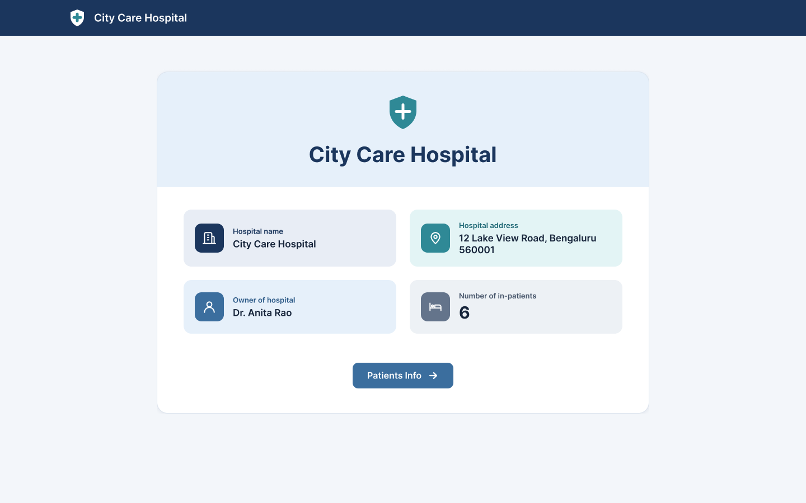
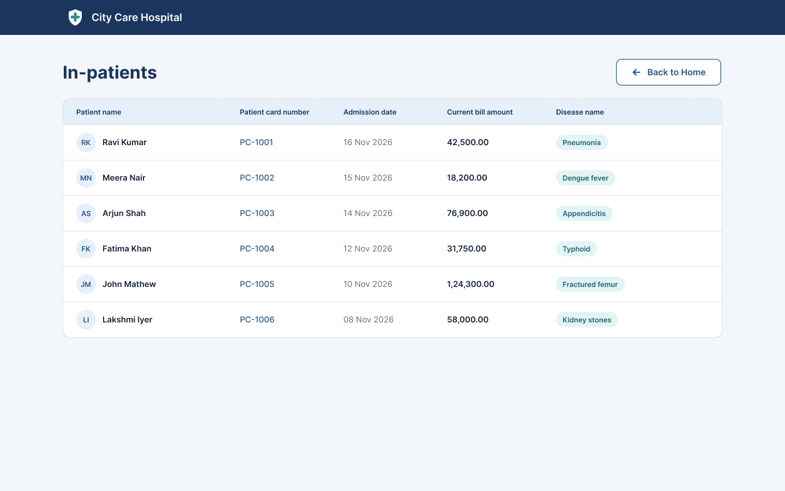
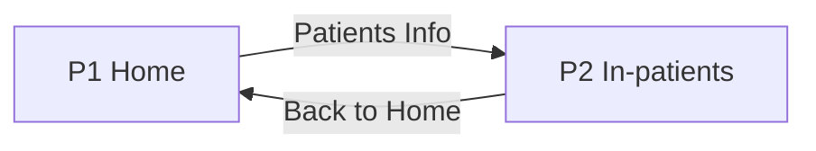
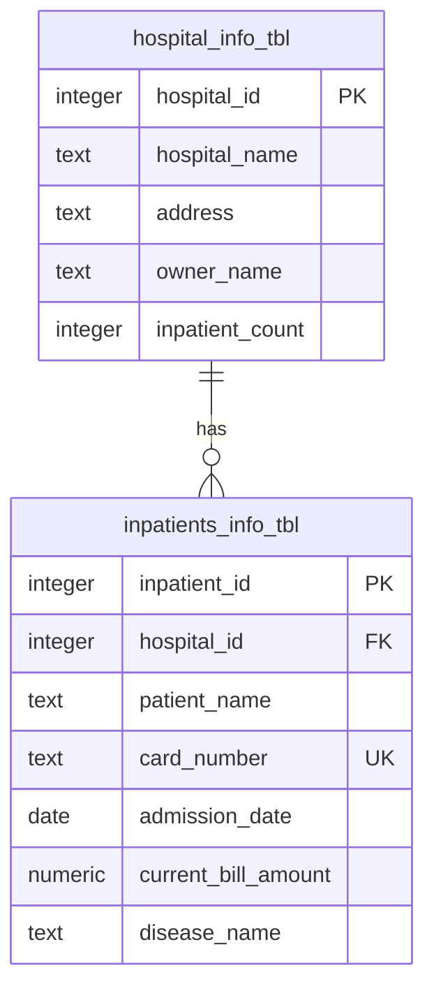

# Hospital Portal — Business Specification

| | |
|---|---|
| Status | Draft for owner review |
| Version | 0.5 |
| Date | 2026-11-18 |
| Tracking issue | #1 |

## 1. Scope

A learning app with two read-only pages. All values are static: they are loaded into the database once by a seed script and only displayed. There is no login, and no page creates, edits or deletes data. All data is synthetic.

## 2. Pages

Wireframes are designed in Figma: [Hospital Portal Wireframes](https://www.figma.com/design/uHopJPhT4lmqlg2IexKphp). PNG exports are kept in [`docs/design/`](design/).

### P1 — Home

- **Route:** `/`

| Component | Value shown | Source |
|---|---|---|
| Hospital logo | Static image, also shown in the top bar of both pages | `docs/design/hospital-logo.svg` (app asset, not from the database) |
| Page heading | Hospital name | `hospital_info_tbl.hospital_name` |
| Hospital name | Text | `hospital_info_tbl.hospital_name` |
| Hospital address | Text | `hospital_info_tbl.address` |
| Owner of hospital | Text | `hospital_info_tbl.owner_name` |
| Number of in-patients | Whole number | `hospital_info_tbl.inpatient_count` |
| Patients Info button | Opens page P2 | — |

**API:** `GET /api/hospital`

### P2 — In-patients

- **Route:** `/patients`

| Component | Value shown | Source |
|---|---|---|
| Patient name | Text | `inpatients_info_tbl.patient_name` |
| Patient card number | Unique text | `inpatients_info_tbl.card_number` |
| Admission date | Date, `DD MMM YYYY` | `inpatients_info_tbl.admission_date` |
| Current bill amount | Amount with 2 decimals | `inpatients_info_tbl.current_bill_amount` |
| Disease name | Text | `inpatients_info_tbl.disease_name` |
| Back to Home button | Opens page P1 | — |

Rows are sorted by admission date, newest first. If there are no records the page shows "No in-patients found".

**API:** `GET /api/inpatients`

## 3. Navigation

## 4. Business rules

| ID | Rule |
|---|---|
| BR-1 | Both pages are read-only and open to anyone; no login. |
| BR-2 | All values come from the database and are never hard-coded in the UI. |
| BR-3 | Each patient card number is unique. |
| BR-4 | If data cannot be loaded, the page shows "Unable to load data. Please try again." |

## 5. Backend APIs

Both APIs are read-only and return JSON.

| Method and path | Used by | Returns |
|---|---|---|
| `GET /api/hospital` | P1 | `hospitalName`, `address`, `ownerName`, `inpatientCount` |
| `GET /api/inpatients` | P2 | List of `patientName`, `cardNumber`, `admissionDate`, `currentBillAmount`, `diseaseName` |

## 6. Database

| | |
|---|---|
| Platform | Supabase (PostgreSQL) |
| Supabase project name | `hospital-portal` |
| Database name | `postgres` (fixed by Supabase) |
| Schema | `public` |
| Tables | 2 |

Key: PK = primary key, FK = foreign key, UK = unique key (no two rows can have the same value).

One hospital has many in-patients. Each in-patient row points to its hospital through `hospital_id`.

### `hospital_info_tbl` — one row

| Column | Data type | Constraints |
|---|---|---|
| hospital_id | integer | Primary key |
| hospital_name | text | Not null |
| address | text | Not null |
| owner_name | text | Not null |
| inpatient_count | integer | Not null, ≥ 0 |

### `inpatients_info_tbl` — one row per in-patient

| Column | Data type | Constraints |
|---|---|---|
| inpatient_id | integer | Primary key, auto-generated |
| hospital_id | integer | Not null, foreign key → `hospital_info_tbl.hospital_id` |
| patient_name | text | Not null |
| card_number | text | Not null, unique |
| admission_date | date | Not null |
| current_bill_amount | numeric(10,2) | Not null, ≥ 0 |
| disease_name | text | Not null |

### Constraint names

| Constraint | Name |
|---|---|
| Primary key, hospital | `pk_hospital_info_tbl` |
| Primary key, in-patient | `pk_inpatients_info_tbl` |
| Foreign key, in-patient → hospital | `fk_inpatients_info_tbl_hospital_id` |
| Unique card number | `uq_inpatients_info_tbl_card_number` |
| Bill amount ≥ 0 | `ck_inpatients_info_tbl_current_bill_amount` |
| In-patient count ≥ 0 | `ck_hospital_info_tbl_inpatient_count` |
| Index on the foreign key | `idx_inpatients_info_tbl_hospital_id` |

Naming follows the project conventions in `CLAUDE.md`.

### Seed data

A seed script inserts one `hospital_info_tbl` row and six synthetic `inpatients_info_tbl` rows linked to it. `inpatient_count` is set to the number of seeded in-patient rows.
