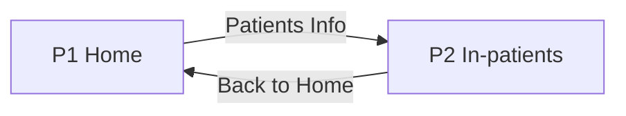
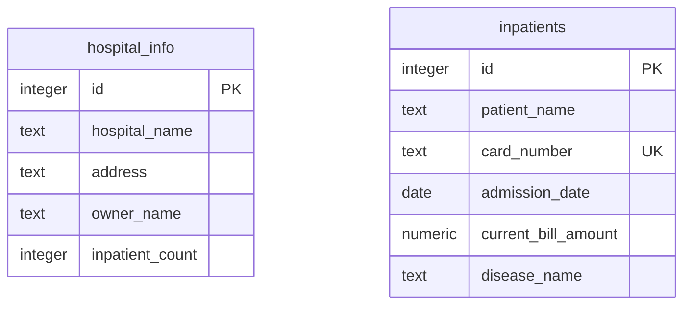

# Hospital Portal — Business Specification

| | |
|---|---|
| Status | Draft for owner review |
| Version | 0.2 |
| Date | 2026-11-18 |
| Tracking issue | #1 |

## 1. Scope

A learning app with two read-only pages. All values are static: they are loaded into the database once by a seed script and only displayed. There is no login, and no page creates, edits or deletes data. All data is synthetic.

## 2. Pages

### P1 — Home

- **Route:** `/`

```
+----------------------------------------------+
|              <Hospital Name>                 |
|                                              |
|  Hospital name         <value>               |
|  Hospital address      <value>               |
|  Owner of hospital     <value>               |
|  Number of in-patients <value>               |
|                                              |
|              [ Patients Info ]               |
+----------------------------------------------+
```

| Component | Value shown | Source |
|---|---|---|
| Page heading | Hospital name | `hospital_info.hospital_name` |
| Hospital name | Text | `hospital_info.hospital_name` |
| Hospital address | Text | `hospital_info.address` |
| Owner of hospital | Text | `hospital_info.owner_name` |
| Number of in-patients | Whole number | `hospital_info.inpatient_count` |
| Patients Info button | Opens page P2 | — |

**API:** `GET /api/hospital`

### P2 — In-patients

- **Route:** `/patients`

```
+------------------------------------------------------------------+
| In-patients                                       [ Back to Home ]|
|                                                                  |
| Patient name | Card number | Admission date | Bill amount | Disease |
| <name>       | <card no>   | <date>         | <amount>    | <name>  |
| <name>       | <card no>   | <date>         | <amount>    | <name>  |
+------------------------------------------------------------------+
```

| Component | Value shown | Source |
|---|---|---|
| Patient name | Text | `inpatients.patient_name` |
| Patient card number | Unique text | `inpatients.card_number` |
| Admission date | Date, `DD MMM YYYY` | `inpatients.admission_date` |
| Current bill amount | Amount with 2 decimals | `inpatients.current_bill_amount` |
| Disease name | Text | `inpatients.disease_name` |
| Back to Home button | Opens page P1 | — |

Rows are sorted by admission date, newest first. If there are no records the page shows "No in-patients found".

**API:** `GET /api/inpatients`

## 3. Navigation



## 4. Business rules

| ID | Rule |
|---|---|
| BR-1 | Both pages are read-only and open to anyone; no login. |
| BR-2 | All values come from the database and are never hard-coded in the UI. |
| BR-3 | Each patient card number is unique. |
| BR-4 | If data cannot be loaded, the page shows "Unable to load data. Please try again." |

## 5. Backend APIs

Both APIs are read-only and return JSON.

| Method and path | Used by | Returns |
|---|---|---|
| `GET /api/hospital` | P1 | `hospitalName`, `address`, `ownerName`, `inpatientCount` |
| `GET /api/inpatients` | P2 | List of `patientName`, `cardNumber`, `admissionDate`, `currentBillAmount`, `diseaseName` |

## 6. Database

| | |
|---|---|
| Platform | Supabase (PostgreSQL) |
| Supabase project name | `hospital-portal` |
| Database name | `postgres` (fixed by Supabase) |
| Schema | `public` |
| Tables | 2 |



The two tables are independent; there is no relationship between them.

### `hospital_info` — one row

| Column | Data type | Constraints |
|---|---|---|
| id | integer | Primary key |
| hospital_name | text | Not null |
| address | text | Not null |
| owner_name | text | Not null |
| inpatient_count | integer | Not null, ≥ 0 |

### `inpatients` — one row per in-patient

| Column | Data type | Constraints |
|---|---|---|
| id | integer | Primary key, auto-generated |
| patient_name | text | Not null |
| card_number | text | Not null, unique |
| admission_date | date | Not null |
| current_bill_amount | numeric(10,2) | Not null, ≥ 0 |
| disease_name | text | Not null |

### Seed data

A seed script inserts one `hospital_info` row and about ten synthetic `inpatients` rows. `inpatient_count` is set to the number of seeded in-patient rows.
