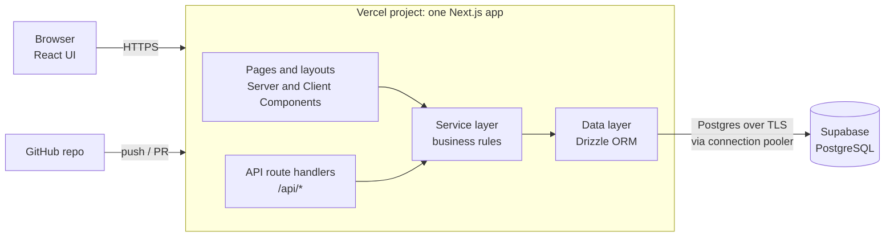

# Hospital Portal — High-Level Technical Solution

| | |
|---|---|
| Status | Draft for owner review |
| Version | 0.1 |
| Date | 2026-11-18 |
| Tracking issue | #1 |
| Companion doc | [Business specification](business-spec.md) |

## 1. Summary

Hospital Portal is one Next.js application that serves both the React user interface and the backend API. It is deployed as a single Vercel project and stores its data in a Supabase PostgreSQL database. The project is a learning app, so every choice below favours free tiers, mainstream tools and simplicity over scale.

Exact package versions are not fixed here. At implementation time the current stable release of each tool is installed and pinned in `package.json` and the lockfile.

## 2. Architecture



- **Browser:** renders pages and calls `/api/*` for data changes.
- **Pages:** fetch their initial data on the server by calling the service layer directly, not over HTTP.
- **API route handlers:** thin HTTP wrappers that authenticate, validate input and call the service layer.
- **Service layer:** holds every business rule in the business spec. It is the only code that pages and APIs share.
- **Data layer:** the only code that talks to the database.

## 3. Technology choices

| Area | Choice | Why |
|---|---|---|
| Language | TypeScript, strict mode, for all frontend and backend code; SQL for migrations | One language end to end, with types shared between UI and API |
| Runtime | Node.js, current LTS | Supported by Vercel and all chosen libraries |
| Framework | Next.js with the App Router | UI and API in one app; first-class on Vercel |
| UI library | React (the version bundled with Next.js) | Owner's choice |
| Styling | Tailwind CSS | Fast to learn, no separate CSS architecture needed |
| UI components | shadcn/ui (built on Radix UI) | Accessible components copied into the repo, so they are easy to read and change |
| Forms | React Hook Form with Zod | The same Zod schema validates in the browser and on the server |
| Client data fetching | TanStack Query for interactive screens | Caching, loading and error states without hand-written code |
| Authentication | Auth.js (NextAuth) with the credentials provider and JWT session cookie | Standard for Next.js; needs no extra tables |
| Password hashing | bcrypt | Well-understood, widely supported |
| Database access | Drizzle ORM with the `postgres` driver | Type-safe queries that stay close to SQL; connects with separate host, user, password and database values |
| Migrations | Drizzle Kit, generating SQL files committed to the repo | Reviewable, repeatable schema changes |
| Package manager | npm | Ships with Node.js; nothing extra to learn |
| Build tool | Next.js built-in build (Turbopack) | No separate bundler to configure |
| Unit and component tests | Vitest with React Testing Library | Fast, TypeScript-native, Jest-compatible API |
| API mocking in tests | Mock Service Worker | Tests components against realistic API responses |
| End-to-end tests | Playwright | Drives a real browser through the main user journeys |
| Code coverage | Vitest coverage with the V8 provider | Built in; produces text, HTML and LCOV reports |
| Linting and formatting | ESLint (Next.js config) and Prettier | Standard for the ecosystem |
| Git hooks | Husky with lint-staged | Lints and formats changed files before each commit |
| CI | GitHub Actions | Runs checks on every PR |
| Hosting | Vercel Hobby plan | Owner's choice; free |
| Database hosting | Supabase free tier | Owner's choice; free |

## 4. Repository layout

```
/
├── CLAUDE.md
├── docs/                      specs and design docs
├── drizzle/                   generated SQL migrations
├── e2e/                       Playwright tests
├── public/                    static assets
├── scripts/seed.ts            synthetic seed data
├── src/
│   ├── app/
│   │   ├── (auth)/            login, register
│   │   ├── (portal)/          signed-in pages: patient/, doctor/, admin/, profile/
│   │   └── api/               route handlers
│   ├── components/
│   │   ├── ui/                shadcn/ui primitives
│   │   └── <feature>/         feature components
│   ├── server/                backend logic (never imported by client code)
│   │   ├── db/                Drizzle schema and client
│   │   ├── services/          business rules, one file per area
│   │   └── auth/              session and role checks
│   ├── lib/                   shared helpers and Zod schemas
│   └── types/
├── .env.example               variable names only, no values
├── .github/workflows/ci.yml
└── package.json
```

The `src/server/` folder is the "backend in its own folder" called for in `CLAUDE.md`.

## 5. Frontend design

- **Rendering:** pages are Server Components by default and load their data on the server. A component becomes a Client Component only when it needs state, effects or browser events (forms, dialogs, filters, the slot picker).
- **Routing:** route groups separate public pages from the signed-in portal. One shared layout provides the top bar and role-based side navigation.
- **Access control in the UI:** middleware redirects signed-out users to `/login` and users on another role's pages to their own dashboard. This is for user experience only; the real checks are on the server (section 6).
- **State:** server data lives in TanStack Query or server-rendered props; form state in React Hook Form; filters and pagination in the URL so pages can be bookmarked. No global state library.
- **Forms:** every form has a Zod schema in `src/lib/`, shared with its API.
- **Feedback:** loading skeletons, inline field errors, toasts for results, confirmation dialogs for destructive actions.
- **Accessibility:** semantic HTML, labelled inputs, keyboard-operable dialogs and menus, visible focus, and WCAG AA colour contrast.
- **Responsive:** usable from 360 px phones to desktop; tables scroll horizontally or collapse to cards on small screens.
- **Design specs:** the wireframes in the business spec define layout and content. Visual style is the default shadcn/ui theme with one brand colour, defined as Tailwind theme tokens.

## 6. Backend design

- **API style:** REST over JSON, implemented as Next.js route handlers, listed in the business spec.
- **Handler pattern:** every handler does the same four steps: get the session, check the role, validate input with Zod, call a service function. Handlers contain no business rules.
- **Service layer:** functions such as `bookAppointment` and `completeConsultation` enforce the business rules and ownership checks (a patient only touches their own records).
- **Transactions:** multi-step changes run in one database transaction, for example completing a consultation (visit note, prescription, status and invoice together).
- **Double-booking:** prevented by a partial unique index in the database, with the unique-violation error mapped to a `409` response. The application does not rely on check-then-insert.
- **Errors:** one helper maps validation, authentication, permission, not-found and conflict errors to the response format in the business spec. Unexpected errors are logged and returned as a generic `500` without internal detail.
- **Time:** timestamps are stored in UTC. Appointment dates and times are stored as local date and time in the hospital's time zone, set by the `HOSPITAL_TIMEZONE` variable.

## 7. Authentication and authorisation

- **Sign-in:** Auth.js credentials provider checks the email and bcrypt password hash in the `users` table.
- **Session:** a signed, encrypted JWT in an HTTP-only, secure, same-site cookie. It carries the user id and role. Sessions expire after 8 hours.
- **Authorisation:** enforced on the server in every route handler and server-rendered page, through shared `requireRole` and ownership helpers.
- **Brute-force protection:** a simple per-email failed-attempt limit. This is basic and suitable for a learning app only.

## 8. Database design

- **Schema:** nine tables, defined in the business spec. The Drizzle schema in `src/server/db/` is the source of truth.
- **Keys:** UUID primary keys; foreign keys on every relationship.
- **Integrity in the database:** not-null, unique and check constraints back up application validation, so bad data cannot be written even by a bug.
- **Value lists:** stored as `text` with check constraints instead of PostgreSQL enum types, because adding a value is then a simple migration.
- **Money:** `numeric(10,2)`, never floating point.
- **Indexes:** on foreign keys and on the columns used by list filters (appointment date, status).
- **Migrations:** every schema change is a generated SQL file in `drizzle/`, reviewed in a PR and applied by a script. The live database is never edited by hand.
- **Seed:** `scripts/seed.ts` loads synthetic data only.

### 8.1 Configuration values

The server connects to the database with the four values set by the owner, plus three supporting values.

| Variable | Meaning | Example |
|---|---|---|
| `DB_USER` | Database username | `postgres.<project-ref>` |
| `DB_PASSWORD` | Database password | (secret) |
| `DB_URL` | Database host and port (the Supabase pooler address) | `aws-0-<region>.pooler.supabase.com:6543` |
| `DB_NAME` | Database name | `postgres` |
| `AUTH_SECRET` | Key that signs session cookies | (secret) |
| `HOSPITAL_TIMEZONE` | Time zone for appointment times | `Asia/Kolkata` |
| `CURRENCY_SYMBOL` | Symbol shown before amounts | `₹` |

Values live in Vercel environment variables and in an untracked `.env.local` on a developer machine. `.env.example` lists the names only.

## 9. Supabase practices

- **Use:** Supabase is used as a managed PostgreSQL database. Supabase Auth, Storage and the auto-generated Data API are not used.
- **Connection pooling:** the app connects through Supabase's connection pooler in transaction mode, because Vercel functions open many short-lived connections. Prepared statements are disabled in the driver, as transaction mode requires. Migrations use the direct or session-mode connection.
- **Row-level security:** enabled on every table with no policies. The app connects as a privileged database role that bypasses it, so this changes nothing for the app, but it blocks all access through Supabase's public Data API if that is ever switched on.
- **TLS:** required on every connection.
- **Region:** the Supabase project and the Vercel function region are set to the same or nearest region to keep queries fast.
- **Free-tier limits to plan around:** free projects are paused after a period of inactivity and must be resumed manually; there are no automatic backups; database size is capped. These are acceptable for a learning app and should be re-checked against Supabase's current pricing page at setup.
- **Advisors:** Supabase's security and performance advisors are reviewed after each schema change.

## 10. Vercel practices

- **One project** linked to the GitHub repo, with the framework preset set to Next.js.
- **Deployments:** every PR gets a preview deployment; merging to `main` deploys to production. Nobody deploys by hand.
- **Environment variables:** set separately for Production and Preview. Nothing secret uses the `NEXT_PUBLIC_` prefix, because those values are sent to the browser.
- **Preview data:** preview deployments use the same Supabase database as production, because the free tier and the learning scope do not justify a second database. This is safe only because all data is synthetic.
- **Functions:** API handlers run on the Node.js runtime (the database driver needs it), in the region nearest the database.
- **Hobby plan limits:** personal, non-commercial use only, with caps on function duration and monthly usage. This fits a learning app and should be re-checked against Vercel's current pricing page at setup.
- **Caching:** all portal pages and APIs are per-user and are not cached. Only static assets are cached.

## 11. Testing strategy

| Level | Tool | What it covers | Where |
|---|---|---|---|
| Unit | Vitest | Service-layer business rules, slot generation, Zod schemas, helpers | Next to the code as `*.test.ts` |
| Component | Vitest, React Testing Library, Mock Service Worker | Forms, tables, dialogs: rendering, validation and user interaction | Next to the component as `*.test.tsx` |
| API | Vitest | Route handlers: status codes, role checks, validation | `src/app/api/**/*.test.ts` |
| End-to-end | Playwright | Main journeys: register and book; doctor completes consultation; admin records payment | `e2e/` |

- **Coverage:** measured by Vitest's V8 coverage on every CI run. The build fails below 80% lines, functions and statements and 75% branches. The service layer targets 90%.
- **Database in tests:** unit tests of services mock the data layer. A small set of integration tests runs against a local PostgreSQL container in CI to verify constraints such as the double-booking index.
- **Every PR** that changes behaviour includes or updates tests.

## 12. Code quality and CI

GitHub Actions runs these checks on every PR, and all must pass before merge:

1. Install with `npm ci`.
2. Lint with ESLint and check formatting with Prettier.
3. Type-check with `tsc --noEmit`.
4. Run unit, component and API tests with coverage thresholds.
5. Build with `next build`.
6. Run Playwright end-to-end tests against the build.

Locally, Husky and lint-staged run the linter and formatter on staged files before each commit.

## 13. Best practices checklist

### React

- Function components and hooks only.
- Small, single-purpose components; shared logic in custom hooks.
- Derive values during render instead of copying props into state.
- Stable, meaningful `key` values on lists; never the array index for changing lists.
- Effects only for synchronising with something outside React, not for data transformation.
- Controlled forms through React Hook Form; no manual per-field state.
- No premature memoisation; measure first.
- Error boundaries around each page section.

### Next.js

- Server Components by default; `"use client"` at the smallest possible boundary.
- Server-only code marked with the `server-only` package so it cannot be bundled for the browser.
- `loading.tsx`, `error.tsx` and `not-found.tsx` for every route segment that fetches data.
- `next/link` for navigation, `next/image` for images, `next/font` for fonts.
- Page metadata set through the Metadata API.
- Authorisation checked in handlers and pages, never only in middleware.
- All request input validated with Zod before use.
- Dynamic rendering for per-user pages; no accidental caching of private data.

### Database

- All queries parameterised through the ORM; no string-built SQL.
- Constraints in the database as well as validation in the app.
- Transactions for multi-step writes.
- Explicit column lists; never return `password_hash` from a query used by an API.
- Paginate every list endpoint.
- Migrations are forward-only and reviewed.

### Security

- Secrets only in environment variables; `.env*` files ignored by Git except `.env.example`.
- Passwords hashed with bcrypt; never logged or returned.
- HTTP-only, secure, same-site session cookies.
- Security headers set in `next.config`: content security policy, `X-Content-Type-Options`, `Referrer-Policy`, frame restrictions.
- No personal data in logs or error messages.
- Dependencies kept current with Dependabot and `npm audit` in CI.
- Synthetic data only, in every environment.

### Git and delivery

- Follows `CLAUDE.md`: one GitHub issue per piece of work, a `feature/<issue_id>/<description>` branch, a PR, and merge by the owner.
- Small PRs with a description of what changed and how it was verified.
- Conventional, descriptive commit messages.

## 14. Suggested delivery order

Each step is a separate issue and PR, started only after the owner approves it.

1. Project scaffold: Next.js app, tooling, CI, Vercel project, Supabase project.
2. Database schema, migrations and seed.
3. Authentication and the application shell.
4. Master data: departments, doctors, schedules.
5. Appointments: find a doctor, booking, lists, cancellation.
6. Consultation: visit notes and prescriptions.
7. Billing.
8. Dashboards, end-to-end tests and polish.

## 15. Risks and open decisions

| # | Item | Proposed handling |
|---|---|---|
| 1 | Supabase free projects pause when idle | Accept; resume manually when needed |
| 2 | Hand-managed passwords are a security responsibility | Acceptable for learning with synthetic data. Supabase Auth is the alternative if the owner prefers not to store password hashes |
| 3 | Preview and production share one database | Accept while data is synthetic |
| 4 | Drizzle versus Prisma | Drizzle proposed because it fits the four separate DB config values and stays close to SQL; Prisma is a reasonable alternative |
| 5 | Vercel Hobby and Supabase free-tier terms change over time | Re-check both pricing pages when the projects are created |
