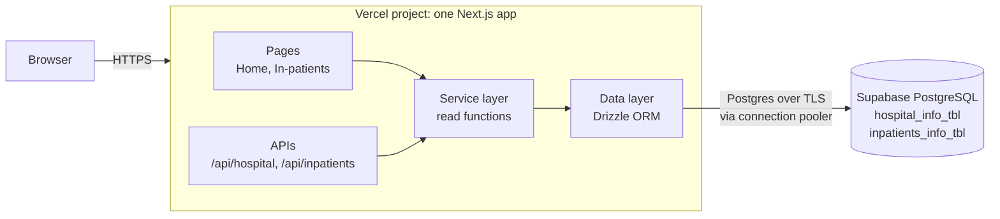

# Hospital Portal — High-Level Technical Solution

| | |
|---|---|
| Status | Draft for owner review |
| Version | 0.2 |
| Date | 2026-11-18 |
| Tracking issue | #1 |
| Companion doc | [Business specification](business-spec.md) |

## 1. Summary

Hospital Portal is a learning app with two read-only pages, Home and In-patients. It is one Next.js application that serves both the React pages and the two backend APIs, deployed as a single Vercel project (Hobby plan) and reading from a Supabase PostgreSQL database (free tier). There is no login and nothing writes to the database except the seed script.

Package versions are not fixed here. The current stable release of each tool is installed at build time and pinned in `package.json` and the lockfile.

## 2. Architecture



- **Pages** are rendered on the server. Each page gets its data by calling the service layer directly.
- **APIs** return the same data as JSON, through the same service functions.
- **Service layer** has two read functions: `getHospitalInfo` and `getInpatients`.
- **Data layer** is the only code that talks to the database.

## 3. Technology choices

| Area | Choice | Why |
|---|---|---|
| Language | TypeScript (strict) for all code; SQL for migrations | One language for UI and backend, with shared types |
| Runtime | Node.js, current LTS | Supported by Vercel and all chosen libraries |
| Framework | Next.js with the App Router | UI and API in one app; first-class on Vercel |
| UI library | React (bundled with Next.js) | Owner's choice |
| Styling | Tailwind CSS | Simple, no separate CSS architecture |
| Font | Inter, loaded with `next/font` | Matches the Figma design |
| Database access | Drizzle ORM with the `postgres` driver | Type-safe queries close to SQL; takes host, user, password and database as separate values |
| Migrations | Drizzle Kit, generating SQL files kept in the repo | Reviewable, repeatable schema changes |
| Package manager | npm | Ships with Node.js |
| Build tool | Next.js built-in build (Turbopack) | No separate bundler to configure |
| Unit and component tests | Vitest with React Testing Library | Fast and TypeScript-native |
| End-to-end tests | Playwright | Checks both pages and the navigation in a real browser |
| Code coverage | Vitest coverage with the V8 provider | Built in; text, HTML and LCOV reports |
| Linting and formatting | ESLint (Next.js config) and Prettier | Standard for the ecosystem |
| CI | GitHub Actions | Runs checks on every PR |
| Hosting | Vercel Hobby plan | Owner's choice; free |
| Database hosting | Supabase free tier | Owner's choice; free |

Not needed for this scope, so left out: authentication, form and validation libraries, client-side data fetching and state libraries.

## 4. Repository layout

```
/
├── CLAUDE.md
├── docs/                         specs and designs
├── drizzle/                      generated SQL migrations
├── e2e/                          Playwright tests
├── public/hospital-logo.svg      logo asset
├── scripts/seed.ts               synthetic seed data
├── src/
│   ├── app/
│   │   ├── layout.tsx            top bar with logo and hospital name
│   │   ├── page.tsx              P1 Home
│   │   ├── patients/page.tsx     P2 In-patients
│   │   └── api/
│   │       ├── hospital/route.ts
│   │       └── inpatients/route.ts
│   ├── components/               HospitalCard, InfoTile, InpatientsTable, ...
│   ├── server/                   backend logic, never imported by browser code
│   │   ├── db/                   Drizzle schema and client
│   │   └── services/             getHospitalInfo, getInpatients
│   └── lib/                      formatting helpers (date, amount)
├── .env.example                  variable names only
├── .github/workflows/ci.yml
└── package.json
```

## 5. Frontend design

- **Rendering:** both pages are Server Components rendered on each request, so they always show the current database values. No Client Components are needed; the two buttons are plain links.
- **Navigation:** "Patients Info" and "Back to Home" use `next/link`.
- **States:** each page has a `loading.tsx` skeleton and an `error.tsx` showing "Unable to load data. Please try again." The In-patients page shows "No in-patients found" when the table is empty.
- **Formatting:** dates as `DD MMM YYYY` and amounts with two decimals, in shared helpers.
- **Design source:** the Figma file and exports in `docs/design/`. The colours below are defined once as Tailwind theme tokens.

| Token | Colour | Used for |
|---|---|---|
| Navy | `#1B365D` | Top bar, headings |
| Steel blue | `#3B6E9E` | Primary button, links |
| Teal | `#2F8996` | Logo, accents, disease pills |
| Slate | `#64748B` | Secondary text |
| Background | `#F3F6FA` | Page background |

- **Accessibility:** semantic HTML (a real `<table>` with header cells, one `<h1>` per page), alt text on the logo, visible keyboard focus, WCAG AA contrast.
- **Responsive:** tiles stack in one column and the table scrolls horizontally on small screens.

## 6. Backend design

- **APIs:** `GET /api/hospital` and `GET /api/inpatients`, as Next.js route handlers on the Node.js runtime. Both are read-only; other HTTP methods return `405`.
- **Responses:** `200` with `{ "data": ... }`; on failure `500` with `{ "error": { "message": "..." } }` and no internal detail.
- **Queries:** explicit column lists, parameterised through the ORM. In-patients are ordered by admission date, newest first.
- **Caching:** responses are not cached, so they always reflect the database.

## 7. Database

- **Schema:** two tables, `hospital_info_tbl` and `inpatients_info_tbl`, joined by the foreign key `inpatients_info_tbl.hospital_id`. Columns, types and constraint names are in the business spec. The Drizzle schema in `src/server/db/` is the source of truth for the code.
- **Integrity:** primary keys, the foreign key, not-null, unique and check constraints are all enforced in the database, with an index on the foreign key.
- **Money:** `numeric(10,2)`, never floating point.
- **Migrations:** every schema change is a generated SQL file in `drizzle/`, reviewed in a PR. The live database is never edited by hand.
- **Seed:** `scripts/seed.ts` inserts the one hospital row and the synthetic in-patient rows, and can be re-run safely.

### Configuration values

| Variable | Meaning | Example |
|---|---|---|
| `DB_USER` | Database username | `postgres.<project-ref>` |
| `DB_PASSWORD` | Database password | (secret) |
| `DB_URL` | Database host and port (Supabase pooler address) | `aws-0-<region>.pooler.supabase.com:6543` |
| `DB_NAME` | Database name | `postgres` |

Values live in Vercel environment variables and in an untracked `.env.local` on a developer machine. `.env.example` lists the names only.

## 8. Supabase practices

- **Use:** managed PostgreSQL only. Supabase Auth, Storage and the auto-generated Data API are not used.
- **Connection pooling:** the app connects through Supabase's pooler in transaction mode, with prepared statements disabled, because Vercel functions open short-lived connections. Migrations and the seed use the direct or session-mode connection.
- **Row-level security:** enabled on both tables with no policies. The app's database role is unaffected, but all access through Supabase's public Data API is blocked.
- **TLS:** required on every connection.
- **Region:** the Supabase project and the Vercel function region are the same or nearest.
- **Free-tier limits:** free projects pause after a period of inactivity and must be resumed manually, and have no automatic backups. Re-check Supabase's pricing page at setup.

## 9. Vercel practices

- **One project** linked to the GitHub repo, framework preset Next.js.
- **Deployments:** a preview deployment for every PR; production deploys only when the owner merges to `main`.
- **Environment variables:** the four database values, set for Production and Preview. None use the `NEXT_PUBLIC_` prefix, so none reach the browser.
- **Preview data:** previews read the same Supabase database as production, which is acceptable because all data is synthetic and read-only.
- **Hobby plan:** personal, non-commercial use only, with usage caps. Re-check Vercel's pricing page at setup.

## 10. Testing

| Level | Tool | What it covers |
|---|---|---|
| Unit | Vitest | Service functions (data layer mocked), date and amount formatting |
| Component | Vitest, React Testing Library | Home card and in-patients table render the given values; empty state |
| API | Vitest | Both route handlers: success shape, error response, `405` on other methods |
| End-to-end | Playwright | Home shows the four values; "Patients Info" opens the table; "Back to Home" returns |

- **Coverage:** Vitest V8 coverage on every CI run; the build fails below 80% lines, functions and statements, and 75% branches.
- **Every PR** that changes behaviour includes or updates tests.

## 11. Code quality and CI

GitHub Actions runs on every PR, and all steps must pass before merge:

1. `npm ci`
2. ESLint and Prettier check
3. Type-check with `tsc --noEmit`
4. Unit, component and API tests with coverage thresholds
5. `next build`
6. Playwright end-to-end tests

## 12. Best practices checklist

**React**
- Function components only; small, single-purpose components.
- Stable `key` on table rows (the in-patient id).
- No state or effects where none are needed; these pages need none.

**Next.js**
- Server Components by default; no `"use client"` unless a component needs browser interactivity.
- Server-only code marked with the `server-only` package.
- `loading.tsx`, `error.tsx` and `not-found.tsx` provided.
- `next/link`, `next/image` and `next/font` for links, the logo and the font.
- Page titles set through the Metadata API.

**Database**
- Constraints in the database, not only in code.
- Parameterised queries and explicit column lists.
- Forward-only, reviewed migrations.

**Security**
- Secrets only in environment variables; `.env*` ignored by Git except `.env.example`.
- Security headers set in `next.config`.
- Synthetic data only; no personal data in logs.
- Dependabot and `npm audit` in CI.

**Naming and Git**
- Naming conventions and Git flow as defined in `CLAUDE.md`.

## 13. Suggested delivery order

Each step is its own issue and PR, started only after the owner approves it.

1. Project scaffold: Next.js app, tooling, CI.
2. Supabase project, schema migration and seed data.
3. Service layer and the two APIs.
4. Home page.
5. In-patients page.
6. Vercel project, environment variables and first deployment.

## 14. Risks and open points

| # | Item | Proposed handling |
|---|---|---|
| 1 | Supabase free projects pause when idle, which makes both pages show the error state | Accept; resume the project manually |
| 2 | `inpatient_count` is a stored value and can differ from the number of rows in `inpatients_info_tbl` | Accept, as specified; the seed script keeps them equal |
| 3 | No login, so anyone with the URL can see the pages | Acceptable only because all data is synthetic |
| 4 | Vercel Hobby and Supabase free-tier terms change over time | Re-check both pricing pages at setup |
